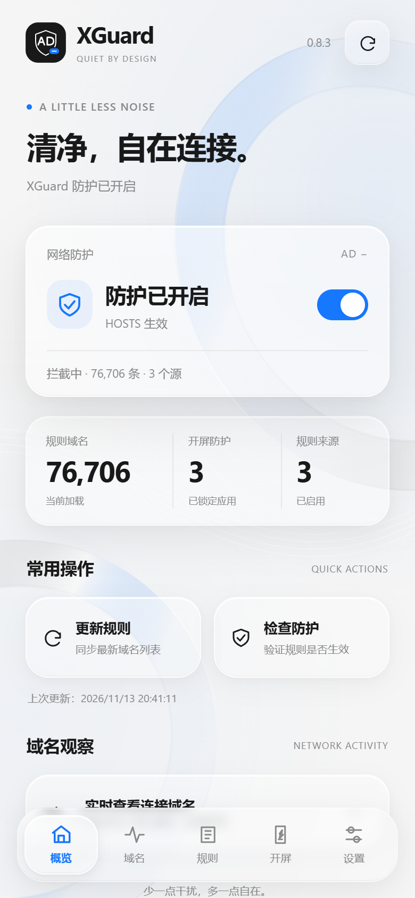
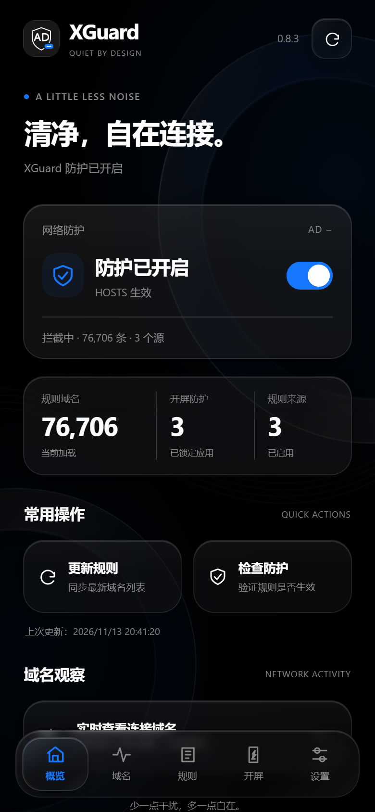
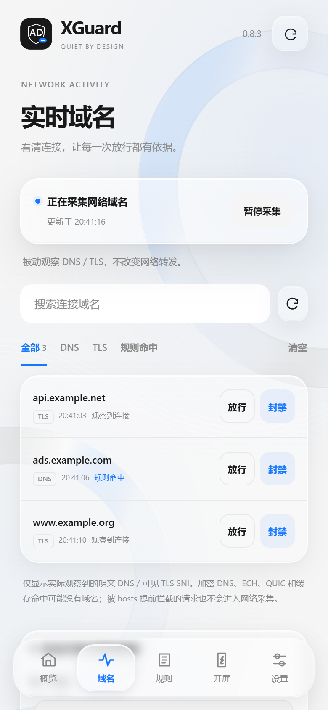

# XGuard

当前开发版本：**0.9.2**，遵循 GNU GPL v3.0。完整许可与第三方归属见 [LICENSE](LICENSE)、[ACKNOWLEDGEMENTS.md](ACKNOWLEDGEMENTS.md) 和 [THIRD_PARTY_NOTICES.md](THIRD_PARTY_NOTICES.md)。

Android 广告域名防护工具，提供 **Root 模块版**和**免 Root 本地 VPN 版**，使用同一套浅色 / 深色玻璃风格界面。

二次创作与维护：**Xuan**。本项目基于原作者 **惜故里丶** 的原始作品进行整理和改进，感谢原作者的工作；原有规则与第三方项目的署名继续保留。

**0.9.2 为本地开发版本，尚未发布。** 安装包位于 `dist/`；[已发布版本](https://github.com/oneorendless/XGuard/releases) · [致谢与来源](ACKNOWLEDGEMENTS.md)。

**v0.9.2** 在 GKD 页面显眼位置增加“隐藏最近任务”开关，选择后会从系统最近任务列表隐藏 XGuard，并持久化到下次启动。GKD 页面继续支持逐个勾选订阅、更新来源、下载并删除自定义 HTTPS 订阅，首次打开提示 Root / VPN 与无障碍授权。仅执行兼容的开屏规则；不支持的复杂选择器与限制条件整条跳过，并展示未导入数量。域名防护、缓存规则和健康维护能力继续保留。

## 两个版本怎么选

| 项目 | 模块版 | 免 Root 版 |
| --- | --- | --- |
| 系统要求 | Android 11 及以上，具备 Root 环境 | Android 6.0 及以上 |
| 安装方式 | Magisk / KernelSU / SukiSU / APatch 管理器安装模块 | 直接安装 APK，允许系统 VPN 授权 |
| 防护方式 | 系统 hosts 规则 | `VpnService` 拦截本地 IPv4 UDP DNS 查询 |
| 域名观察 | 明文 DNS 与可见 TLS SNI | 经本地 VPN 处理的明文 DNS |
| 规则管理 | 预制订阅、域名放行 / 封禁、自定义来源 | 预制订阅勾选、手动更新、域名放行 / 封禁 |
| 开屏缓存管理 | 支持按规则锁定 / 解锁应用广告缓存 | 无法进行需要 Root 的缓存锁定 |
| 网络占用 | 不占用 Android VPN 槽位 | 占用 Android VPN 槽位，通常不能和其他 VPN 同时使用 |

两个 APK 使用同一个包名 `com.xuan.xguard`，**不能同时安装**。版本切换前请先保留所需设置；签名不同时不能直接覆盖安装。

## 界面预览

<p>
  
  
  
</p>

以上为模块版界面预览，截图使用测试接口数据；规则数量和防护状态以实际设备为准。免 Root 版沿用这套界面，部分依赖 Root 的选项不可用。

## 模块版

模块版在系统层加载 hosts 规则，适合已有 Root 环境的设备。

- 管理广告域名规则、订阅来源和手动放行 / 封禁名单。
- 被动观察网络接口上的明文 DNS 和可见 TLS SNI，支持搜索、筛选和按域名操作。
- 按预制或自定义规则锁定、解锁开屏广告缓存。
- 提供防护检查、日志、诊断及安全模式。
- 安装器兼容原有配置迁移；更多说明见 [模块说明](module/README.md)。

安装步骤：

1. 使用本地构建产物 `dist/XGuard-v0.9.2-module.zip`。
2. 在 Magisk / KernelSU / SukiSU / APatch 管理器中从本地安装模块，完成后重启。
3. 打开 XGuard，点击“授权并连接”，在 Root 管理器中授予权限。
4. 按需选择来源并更新规则。其他修改 hosts 的模块可能产生冲突，请避免重复启用。

模块会安装配套应用；如需手动补装，使用 `dist/XGuard-v0.9.2-root.apk`。该 APK 是模块的管理界面，单独安装不能替代模块。

## 免 Root 版

免 Root 版通过 Android `VpnService` 处理本地 DNS 请求，不需要 Root，也不修改系统 hosts。

1. 使用本地构建产物 `dist/XGuard-v0.9.2-no-root.apk`。
2. 打开应用，点击“授权并连接”，同意系统 VPN 授权。
3. 在“规则”页勾选预制来源，返回概览点击“更新规则”，下载完成后合并加载。
4. 根据系统提示允许通知，将电量策略设为“不受限制”，开启厂商自启动；必要时在最近任务中手动锁定应用。各项系统开关需自行设置。

离线基线约 **76,759** 条，首次安装即可使用。网络订阅按需下载并去重，最终数量随所选来源和上游更新变化，并非所有来源条数相加。

预制目录包括 AWAvenue、anti-AD、GOODBYEADS、AdAway、AdRules、Hagezi Light / Pro、1Hosts Lite、AdGuard DNS / Mobile、StevenBlack、HTTPDNS 和 DoH/DoT 服务域名列表。默认启用内置基线、AWAvenue、anti-AD、GOODBYEADS、AdAway。

当前免 Root 实现以**手动更新预制源**为准：自定义来源地址可保存，但尚未接入下载；更新间隔可以保存，但尚无后台定时下载任务。更多说明见 [免 Root 版说明](no-root/README.md)。

## 防护范围

GKD 页提供独立的「无障碍守护」开关（默认关闭）。Root 模块复用原有守护进程，每 120 秒检查一次；首次手动开启过无障碍后，可恢复丢失的授权项或重新绑定失效的服务。两次恢复至少间隔 300 秒，保留其他无障碍服务。模块禁用、安全模式、切换用户或首次解锁前不恢复；主动停用无障碍前请先关闭守护。免 Root 版不能自动修改系统无障碍授权，需要在系统设置重新开启。

域名规则不能覆盖全部广告场景。与正常内容共用域名、已经建立的连接、DNS 缓存和应用自带解析器都可能影响效果。

- 模块版的“规则命中”表示域名被当前规则覆盖，不能仅凭观察记录认定连接已被阻断。
- 免 Root 版当前仅处理 **IPv4 UDP DNS**，不解密 HTTPS，不覆盖 DoH/DoT、QUIC、IPv6 DNS 或应用自带 DNS。选择 DoH/DoT 服务域名列表也不会赋予解密或拦截所有加密 DNS 的能力。
- 免 Root 版的开屏管理、hosts 挂载等 Root 功能不可用；保留的界面选项不代表已实现同等能力。
- 规则可能误拦正常服务，可先减少来源，或将相关域名加入放行名单。

## 下载文件

| Release 文件 | 用途 |
| --- | --- |
| `XGuard-v0.9.2-module.zip` | 可刷入的 Root 模块安装包 |
| `XGuard-v0.9.2-root.apk` | 模块版配套管理应用 |
| `XGuard-v0.9.2-no-root.apk` | 可独立安装的免 Root 应用 |
| `XGuard-v0.9.2-source.zip` | 包含模块与免 Root 版的源码快照，不能刷入 |
| `SHA256SUMS.txt` | 上述文件的 SHA-256 校验值 |

GitHub 自动生成的 `Source code (zip)` / `Source code (tar.gz)` 也是源码归档，**不是模块刷机包**。

## 源码目录与构建

```text
app/                 模块配套 Android 应用源码
module/              Root 模块、规则、WebUI 与预编译采集器
monitor/             DNS / TLS SNI 采集器 Go 源码与测试
no-root/             免 Root Android 应用源码与构建脚本
shared/              两版共用的应用名称与图标读取代码
tests/               界面、开屏规则、缓存扫描和 VPN 验证脚本
docs/                构建说明、界面预览与已有验证记录
build-app.ps1        模块版 APK 构建脚本
build-release.ps1    模块 ZIP 打包与一致性检查脚本
```

构建需要 JDK 17、Android SDK Platform 35 / Build Tools 35.0.0；采集器需要 Go 1.23 或以上。签名密钥需自行准备，仓库不提供密钥。详见 [构建说明](docs/BUILD.md)。

## 致谢

感谢原作者 **惜故里丶** 的原始作品，XGuard 在其基础上进行二次创作。感谢各规则维护者、开屏规则参考项目与 [PrismalAGSL](https://github.com/styropyr0/PrismalAGSL) 作者 **Saurav Sajeev**。

原作者、规则项目与视觉算法的具体归属见 [ACKNOWLEDGEMENTS.md](ACKNOWLEDGEMENTS.md) 和 [THIRD_PARTY_NOTICES.md](THIRD_PARTY_NOTICES.md)。第三方内容继续适用各自许可证；不能将 PrismalAGSL 的 MIT 许可视为本仓库全部内容的统一许可。
